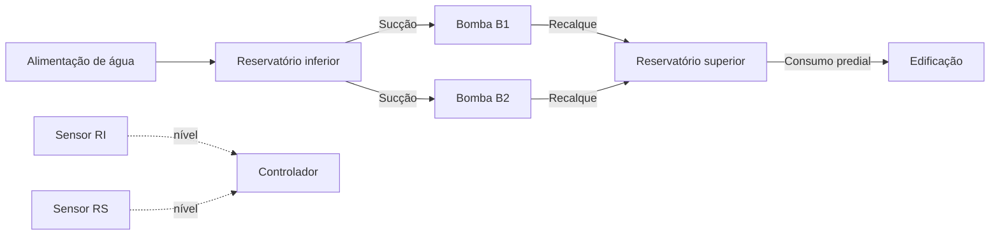
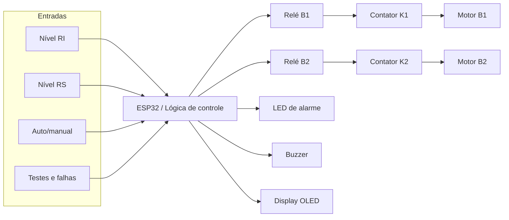
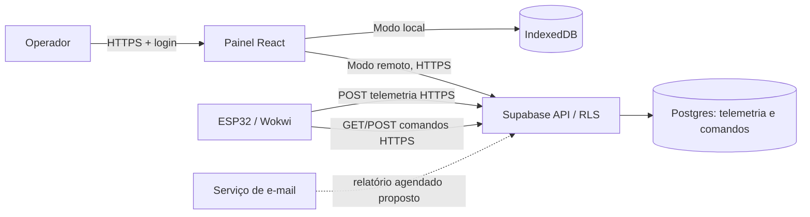

# Diagramas do sistema

## Diagrama hidráulico

## Diagrama de comando

Em instalação física, K1 e K2 devem incluir disjuntor-motor/relé térmico, disjuntor geral, parada de emergência e circuito de comando compatível com as normas aplicáveis. Esses itens são previstos, não uma implementação de potência no Wokwi.

## Arquitetura de comunicação

O modo local está implementado. O caminho remoto depende de publicação do Supabase, credenciais e validação do ESP32/Wokwi.

## Referência de ligação do protótipo

O diagrama executável de ESP32, display, relés, LEDs, buzzer, potenciômetros e botões está em [`wokwi/diagram.json`](../../wokwi/diagram.json).
